# Ergebnisoffener Options- & Strategiebericht: Teamprojekt Schlafapnoe
**Auswertung der Starter-Präsentation · Möglichkeiten, Konsequenzen & Entscheidungsgrundlagen**

---

## 1. Was ist nach der Starter-Präsentation gesetzt – und was ist offen?

Bevor wir uns auf ein konkretes Modell oder eine bestimmte Datenpipeline festlegen, trennen wir klar zwischen den **Rahmenbedingungen (die jetzt feststehen)** und unserem **Entscheidungsraum (was wir bis zum nächsten Treffen offen evaluieren)**:

### Gesetzt (Rahmenbedingungen der Betreuer)
1. **Die Pipeline ist das Herzstück:** Es geht um den sauberen Entwurf des Gesamtprozesses (Daten laden $\rightarrow$ Vorverarbeitung $\rightarrow$ Signal-/Feature-Auswahl $\rightarrow$ Klassifikation $\rightarrow$ Auswertung).
2. **Ein Datensatz reicht völlig (z. B. SHHS):** Wir müssen nicht mehrere Datenbanken vereinen.
3. **Reihenfolge:** **Erst das Modell / die Pipeline entscheiden**, danach kümmern wir uns um die Explainability (XAI).
4. **Kein Code im Paper:** Das Paper beschreibt Methodik und Ergebnisse; den Programmcode stellen wir über ein **GitHub- oder GitLab-Repository** bereit.
5. **Medizinische Einschränkung der PSG („One-Night-Effect“):** Aus einer einzigen Schlaflabor-Nacht lässt sich oft schwer eine endgültige klinische Diagnose für eine Schlafstörung stellen (da Patienten in fremder Umgebung schlechter schlafen oder tagesformabhängig atmen).

### Noch komplett offen (Unser Entscheidungsraum für nächste Woche)
* **Klassisches Machine Learning vs. Deep Learning** (oder beides im Vergleich).
* **Ein Gesamtmodell vs. zwei getrennte, signalspezifische Modelle** (z. B. ein Modell für $\text{SpO}_2$/Atmung und ein Modell für EEG).
* **Art der Multimodalen Fusion:** Alle Signale zusammen in den Input geben (*Early/Feature Fusion*) **ODER** für jedes Signal individuell Features berechnen bzw. Entscheidungen am Ende kombinieren (*Late/Decision Fusion*).
* **Konkrete Konfiguration der Pipeline** (Fensterlängen, Filterung, Normalisierung).

---

## 2. Frage für Frage: Welche Möglichkeiten haben wir und was bedeuten sie?

### Frage A: „Use PSG for the data (hard to tell from one night)“ – Was bedeutet das für unser Setup?
Da eine einzelne Nacht für ein globales Patienten-Urteil („Patient ist krank vs. gesund“) fehleranfällig ist, haben wir für die Pipeline **zwei Möglichkeiten**:
* **Möglichkeit 1: Event-/Epochen-Klassifikation (Zeitfenster-Level)**
  * *Was wir tun:* Wir teilen die 8-Stunden-Nacht in kurze Abschnitte (z. B. 10s, 30s oder 60s) und das Modell entscheidet für jedes Fenster: *Ist hier gerade ein Apnoe-Ereignis?*
  * *Was das bedeutet:* Wir haben aus wenigen Patienten sofort zehntausende Trainingsbeispiele. Wir umgehen das „Ein-Nacht-Problem“, weil wir physiologische Ereignisse detektieren statt einer lebenslangen Diagnose.
* **Möglichkeit 2: Schweregrad-Schätzung über die Nacht (AHI-Regression / Night-Level)**
  * *Was wir tun:* Wir zählen die erkannten Events pro Stunde Schlaf zusammen (Apnoe-Hypopnoe-Index, AHI) und teilen in Schweregrade ein (Normal $<5$, Mild $5–15$, Moderat $15–30$, Schwer $\ge 30$).
  * *Was das bedeutet:* Hier schlägt das *One-Night-Problem* stärker durch (z. B. wenn der Patient in dieser Nacht viel wach lag). Genau hier wird das **EEG** spannend, weil nur das EEG verrät, ob der Patient wirklich geschlafen hat!

---

### Frage B: „Machine Learning vs. Deep Learning“ – Was bedeutet das für unsere Arbeit?
Eure Notizen bringen den Unterschied perfekt auf den Punkt:
* *„Deep learning model could be easier because it doesn't need the features“*
* *„Machine Learning needs the computation of every feature (every feature is related to the information of the given signal)“*

Hier sind unsere **drei strategischen Wege**, die wir wählen können:

| Weg | Beschreibung | Vorteil (Was wird leichter?) | Nachteil / Konsequenz (Was wird schwerer?) |
| :--- | :--- | :--- | :--- |
| **Weg 1: Rein Klassisches ML** *(z. B. Random Forest, XGBoost, SVM, Voting)* | Wir programmieren für jedes Signal mathematische Formeln, die aus einem Zeitfenster Zahlenwerte (Features) berechnen. | **Extrem schnelles Training** auf jedem Laptop; man sieht sofort anhand der *Feature Importance*, welches Signal wie viel bringt. | **Hoher Vorab-Aufwand:** Wir müssen uns für *jedes* Signal überlegen, welche Features sinnvoll sind (z. B. $\text{SpO}_2$-Abfalltiefe, EEG-Frequenzbänder, Herzratenvariabilität) und diese fehlerfrei berechnen. |
| **Weg 2: Rein Deep Learning** *(z. B. 1D-CNN, BiLSTM, ResNet)* | Wir geben die gesäuberten Roh-Signalkurven direkt als Zahlen-Arrays in das neuronale Netz. | **Kein Feature Engineering nötig!** Das Netz sucht sich die Muster in der Kurve selbst. | **Black-Box & Rechenzeit:** Wir brauchen GPUs (z. B. Colab) zum Trainieren, müssen Hyperparameter (Layer, Learning Rate) tunen und brauchen später XAI-Methoden wie *Grad-CAM*, um zu verstehen, was das Netz tut. |
| **Weg 3: Vergleichs-Studie (ML vs. DL)** *(Punkt 4 eurer Next Steps)* | Wir bauen **eine** Daten-Vorverarbeitung und testen darauf 1 klassisches ML-Modell gegen 1 Deep-Learning-Modell. | **Stärkstes Paper-Ergebnis:** Wir können wissenschaftlich beweisen, ob sich der Rechenaufwand von Deep Learning gegenüber handgemachten Features lohnt. | Wir müssen zwar ein kleines Set an Basis-Features berechnen *und* ein kleines Netz trainieren, können aber für beides fertigen Code aus bestehenden Papern nutzen. |

---

### Frage C: „Which model to select the best signal?“ & „Tailored to the signal“
In der PSG haben unsere Zielsignale komplett unterschiedliche physikalische Eigenschaften:
1. **$\text{SpO}_2$ (Blutsauerstoff):** Sehr langsam (meist 1 Hz), reagiert erst mit 15–45 Sekunden Verzögerung auf einen Atemstillstand (glatte Kurve mit „Tälern“).
2. **Zweitsignal (z. B. Nasal Airflow, Atemgurte oder Puls/ECG):** Mittelschnell (10–250 Hz), zeigt den Atemstillstand oder Herzschlag-Anstieg sofort an.
3. **EEG (Gehirnströme):** Extrem schnell und chaotisch (125–250 Hz), zeigt kurze Weckreaktionen (*Arousals*, 3–15 Sekunden) am Ende einer Apnoe, wenn das Gehirn Alarm schlägt.

**Wie finden wir heraus, welches Signal am besten ist? (2 Möglichkeiten):**
* **Im Klassischen ML (Feature Selection):** Wir berechnen Features aus $\text{SpO}_2$, Zweitsignal und EEG, geben alle in ein Modell (z. B. Random Forest / XGBoost) und lassen uns über **ANOVA, Gini-Importance oder SHAP** exakt ausgeben, welche Features/Signale die meiste Vorhersagekraft haben.
* **Im Deep Learning (Ablation / Sensor-Toggle oder Attention):** Wir trainieren das Modell einmal nur mit $\text{SpO}_2$, einmal mit $\text{SpO}_2$ + Signal 2, einmal mit EEG und vergleichen die Genauigkeit – oder wir nutzen einen **Attention-Layer**, der automatisch Gewichte pro Signal vergibt.

---

### Frage D: „EEG used to detect sleep apnea $\rightarrow$ compare with output“ & „Two different models possible“
Das ist einer der spannendsten Punkte aus eurem Meeting! Statt alle Signale blind in einen Topf zu werfen, können wir **maßgeschneiderte Modelle pro Signaltyp** nutzen. Hier gibt es drei Möglichkeiten, wie das aussehen kann:

```mermaid
flowchart TD
    subgraph Variante_1 ["Variante 1: Early Fusion (Alles in 1 Modell)"]
        A1["SpO2 + 2. Signal (+ ggf. EEG)"] --> M1["Ein gemeinsames Modell\n(z.B. Multi-Channel DL)"] --> O1["1 Output (Apnoe Ja/Nein)"]
    end

    subgraph Variante_2 ["Variante 2: Feature-Level Fusion (Individuelle Features)"]
        B1["SpO2"] --> F1["SpO2-Features (Drops, Min, Std)"]
        B2["2. Signal (Flow/Belts/ECG)"] --> F2["Atmungs-/Puls-Features"]
        B3["EEG"] --> F3["EEG-Frequenzbänder (Delta, Beta...)"]
        F1 & F2 & F3 --> M2["Klassischer Classifier / Ensemble"] --> O2["1 Output + Feature Ranking"]
    end

    subgraph Variante_3 ["Variante 3: Zwei getrennte Modelle & Output-Vergleich (Late Fusion)"]
        C1["SpO2 (+ 2. Signal)"] --> ModA["Modell A (auf langsame Kurven angepasst,\nz.B. 1D-CNN oder Tree)"] --> OutA["Output A: Atmungs-Apnoe"]
        C2["EEG-Signal"] --> ModB["Modell B (auf schnelle Wellen angepasst,\nz.B. BiLSTM oder Frequenz-ML)"] --> OutB["Output B: Gehirn-Reaktion / Arousal"]
        OutA <-->|"Vergleichen oder per Voting/Ensemble kombinieren"| OutB
    end
```

* **Was Variante 3 (Zwei getrennte Modelle + Output-Vergleich) für euch bedeutet:**
  * Teammitglied A/B kann sich voll auf das **$\text{SpO}_2$-Modell** (inkl. Zweitsignal) konzentrieren.
  * Teammitglied C/D kann sich voll auf das **EEG-Modell** konzentrieren.
  * Am Ende vergleicht ihr beide Vorhersagen: Erkennt das EEG dieselben Apnoe-Phasen wie das $\text{SpO}_2$? Hilft das EEG dabei, Fehlalarme des $\text{SpO}_2$-Sensors (z. B. wenn der Patient wach ist) herauszufiltern?

---

## 3. Wäre „JEV“ als Classifier etwas für uns?

Du hast gefragt, ob **JEV** als Classifier eine Option wäre. Da das Kürzel „JEV“ in verschiedenen Kontexten auftaucht, schauen wir uns die **drei möglichen Bedeutungen** an und bewerten ehrlich, ob das für unser Schlafapnoe-Projekt passt:

### Fall 1: Du meinst „Jev“ von TypeSafe AI (das neue LLM-/System-1-Klassifikationsmodell)
* **Was ist das?** *Jev* ist ein proprietäres KI-Modell (API-Service), das als blitzschneller Klassifikator für **Text-, Prompt- und Agenten-Zustände** (als Ersatz für langsame GPT-Aufrufe in Software-Pipelines) entwickelt wurde.
* **Taugt das für uns?** **Nein, eher nicht.** Unsere Daten sind kontinuierliche **physiologische Zeitreihen (Biosignale wie $\text{SpO}_2$-Kurven und 250-Hz-EEG-Wellen)**. Ein Cloud-Textklassifikator ist weder für medizinische Rohsignale gebaut, noch lässt er sich wissenschaftlich sauber in einem akademischen KES-Paper für Biosignalverarbeitung begründen oder lokal mit Methoden wie Grad-CAM/SHAP erklären.

### Fall 2: Du meinst einen Joint Ensemble / Voting Classifier (oft als „JEV“ oder „Voting Ensemble“ abgekürzt)
* **Was ist das?** Ein **Ensemble- / Voting-Klassifikator** (in Python z. B. `VotingClassifier` oder `StackingClassifier` aus `scikit-learn`), der die Vorhersagen mehrerer unterschiedlicher Modelle kombiniert (z. B. *Soft Voting* über die Wahrscheinlichkeiten von Modell 1 und Modell 2).
* **Taugt das für uns?** **JA, das wäre sogar ein Volltreffer für eure Notizen!**
  * Wenn ihr **zwei verschiedene Modelle** baut (z. B. ein Modell maßgeschneidert für $\text{SpO}_2$ + Atmung und ein zweites Modell maßgeschneidert für EEG, oder eine Kombination aus Random Forest + XGBoost + SVM), dann ist ein **Joint Ensemble / Voting Classifier** genau die Klammer, die am Ende beide Outputs zusammenführt (*Late Decision Fusion*).
  * Ihr könntet dann im Paper zeigen:
    1. Leistung von Modell 1 allein ($\text{SpO}_2$)
    2. Leistung von Modell 2 allein (EEG)
    3. Leistung des **Ensemble/Voting-Classifiers** aus beiden zusammen!

### Fall 3: Tippfehler für einen klassischen ML-Klassifikator (z. B. SVM, XGBoost, kNN, J48)
* Falls aus der Vorlesung oder Weka/Python ein klassischer Algorithmus gemeint war:
  * **SVM (Support Vector Machine):** Einer der häufigsten Klassifikatoren in der Schlafapnoe-Literatur (z. B. in *Peng et al. 2025* mit über 90% Accuracy auf handberechneten Features).
  * **XGBoost / LightGBM / Random Forest:** Aktuell der Goldstandard für tabellarische Features, extrem stark bei der Auswahl des besten Signals (*Feature Selection*) und perfekt kompatibel mit **SHAP** für die spätere Explainability.

---

## 4. Konkreter Plan für eure 5 „Next Steps“ bis nächste Woche

Damit ihr euch heute noch **nicht** blind festlegen müsst, sondern nächste Woche eine fundierte Entscheidung treffen könnt, könnt ihr die 5 Aufgaben so angehen:

1. **„Jeder liest einen Artikel über ein bestimmtes Modell“ (Vorschlag zur Aufteilung):**
   * **Thema 1 (Deep Learning auf Zeitreihen):** Einer schaut sich **1D-CNN / ResNet** an (wie es für $\text{SpO}_2$ + Atmung genutzt wird, z. B. in *Alarcón 2023* oder *Peng 2025*).
   * **Thema 2 (Deep Learning für Sequenzen/EEG):** Einer schaut sich **LSTM / BiLSTM / GRU** an (besonders beliebt für EEG-Signale und zeitliche Abhängigkeiten, siehe *Fathima 2025*).
   * **Thema 3 (Klassisches ML & Bäume):** Einer schaut sich **Random Forest & Gradient Boosting (XGBoost/LightGBM)** inklusive Feature-Berechnung an.
   * **Thema 4 (Klassisches ML & Ensembles):** Einer schaut sich **SVM & Voting/Ensemble-Classifier (Late Fusion)** an.
2. **„Search for articles that have already code in it and recreate that“:**
   * Sucht auf **PapersWithCode.com** oder direkt auf **GitHub** nach Stichworten wie:
     * `"sleep apnea" SHHS python`
     * `"sleep apnea" SpO2 CNN github`
     * `"sleep apnea" EEG classification github`
   * *Wichtig:* Achtet darauf, dass der Code in **Python (PyTorch, TensorFlow/Keras oder scikit-learn)** geschrieben ist und ein klares `README.md` hat.
3. **Im nächsten Meeting (Entscheidung):**
   * Jeder stellt in 3 Minuten sein gelesenes Modell + ein gefundenes GitHub-Repo vor.
   * Ihr legt nebeneinander: *Wie schwer sind die Features für ML zu berechnen vs. wie schnell läuft das gefundene DL-Repo?*
   * Daraufhin entscheidet ihr euch für eure Pipeline-Architektur!
